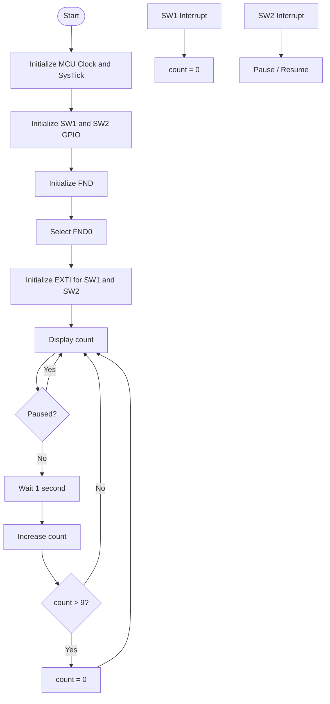

# LAB: EXTI

**Date:** 2026-10-07

**Author/Partner:** 22200551 / Yejun Lee

**Github**: https://github.com/junflower4-dotcom

**Demo Video:** https://youtu.be/IIWu1nmY7rs


## Introduction

In this lab, you are required to create two simple programs using interrupt:

(1) Display the number counting from 0 to 9 with Button Press

(2) Counting at a rate of 1 second


### Requirement

**Hardware**

* MCU
  * NUCLEO-F411RE
* Eval Board (JKIT)
* Actuator/Sensor/Others:

**Software**

* PlatformIO, CMSIS, EC\_HAL library


## Prelab: EXTI Register Setting

Do the PreLAB: External Interrupt

* It is about creating `ecEXTI.*` library
* Fill-in the blanks in the given header files

```c
void EXTI_init(PinName_t pinName, uint32_t trig_type, uint32_t priority);
void EXTI_enable(uint32_t pin);  // mask in IMR
void EXTI_disable(uint32_t pin);  // unmask in IMR
uint32_t  is_pending_EXTI(uint32_t pin);
void clear_pending_EXTI(uint32_t pin);
```


## Problem 1: Counter on 7-Segment display using EXTI

### Problem

Create a code to display the counter-up from 0 to 9 and repeating.

* Count up at the rate of 1 sec.
  
  * Use `delay_ms()` in the main loop
* Pause the counting when SW2 is pressed
* Resets to zero when the push button is pressed: SW1
  
  * Must use External Interrupts for SW1, SW2
  
  

### Procedure

1. Connect the evaluation board [(JKIT-NUCLEO) ](https://ykkim.gitbook.io/ec/ec-course/hardware/stm32f-evaluation-board#reference-manual)to the MCU.
2. Make sure that your library are in `EC\include\`.
   * **ecRCC2.h, ecRCC2.c**
   * **ecGPIO2.h, ecGPIO2.c**
   * **ecPinNames.h, ecPinNames.c**
   * **ecSysTick2.h, ecSysTick2.c**
   * **ecEXTI2.h, ecEXTI2.c**
   * **ecSTM32F4v2.h**
3. Create a new project under the directory `EC\lab\`

* Environment: “**LAB\_EXTI_22200551”.**
* Source File: “**LAB\_EXTI_22200551.c”**

4. You must modify the `platformio.ini` **,** to add new environment.


### Configuration

Configure the MCU GPIO

| Function                           | Port - Pin                                                                                        | Configuration                                 |
| ---------------------------------- | ------------------------------------------------------------------------------------------------- | --------------------------------------------- |
| **Button (SW1) on JKIT**           | PD\_2                                                                                             | DIN, Pull-Up                                  |
| **Button (SW2) on JKIT**           | PA\_4                                                                                             | DIN, Pull-Up                                  |
| **7-Segment DOUT**                 | <p>PB\_0, PB\_1, PB\_2, PB\_3, PB\_4, PB\_5, PB\_6, PB\_7</p><p>('a'\~'g''dot', respectively)</p> | Push-Pull, No Pull-up-Pull-down, Medium Speed |
| **Selection of 7-Segment Display** | PA\_10 (FND\_0)                                                                                   | DOUT, Push-Pull,                              |


### Algorithm

#### Overview

##### Flowchart



#### Description with Code

- The `SW1_PIN` and `SW2_PIN` macros define the GPIO pins used for the reset and pause functions.

```c
#define SW1_PIN    PD_2      // SW1 : Reset counter to zero
#define SW2_PIN    PA_4      // SW2 : Pause / Resume counting
```

- The `pinFND` array stores the GPIO pins connected to the 7-segment display segments, while the `selectFND` array stores the selection pins for FND0 through FND3.

```c
PinName_t pinFND[8] = { PB_0, PB_1, PB_2, PB_3, PB_4, PB_5, PB_6, PB_7};
PinName_t selectFND[4] = {PA_10, PA_11, PC_4, PC_3};
```

- The variables `count`, `reset_flag`, and `pause` are declared as `volatile` because their values can be changed by the interrupt service routines. `count` stores the current number, `reset_flag` indicates a reset event, and `pause` controls the counting state.

```c
volatile uint8_t count = 0;
volatile uint8_t reset_flag = 0;
volatile uint8_t pause = 0;
```

- The `setup()` function initializes the MCU and configures SW1 and SW2 as input pins with pull-up resistors.

```c
// Initialiization 
void setup(void)
{
    // Initialize MCU
    MCU_init();
    
    // Button(SW1) PD2
    GPIO_init(SW1_PIN, INPUT);
    GPIO_pupd(SW1_PIN, PU);

    // Button(SW2) PA4
    GPIO_init(SW2_PIN, INPUT);
    GPIO_pupd(SW2_PIN, PU);
```

- The 7-segment display segment pins and selection pins are initialized using `FND_init()` and `FND_select_init()`. The segment pins are configured with no pull-up/pull-down and medium output speed, and FND0 is selected for displaying the counter.

```c
    // FND
    FND_init(pinFND);
    FND_select_init(selectFND);

    for(int i = 0; i < 8; i++) {
        GPIO_pupd(pinFND[i], NO_PUPD);
        GPIO_ospeed(pinFND[i], MEDIUM_SPEED);
    }

    FND_select(0);
```

- External interrupts are initialized for SW1 and SW2. Since both buttons use pull-up inputs, a falling edge is used to detect each button press. The interrupt priority is set to 10.

```c
    // Initialize EXTI PD_2 (SW1)
    EXTI_init(SW1_PIN, FALL, 10);

    // Initialize EXTI PA_4 (SW2)
    EXTI_init(SW2_PIN, FALL, 10);

}
```

- After `setup()` is completed, the initial value of `count` is displayed. Inside the main loop, the current value of `count` is continuously displayed on the 7-segment display.

```c
// MAIN  ----------------------------------------
int main(void) {

	setup();

    FND_display(count);

	while (1){
        FND_display(count);
```

- When `pause` is `0`, the program waits for 1 second before increasing the counter. If a reset event occurs during the delay, `reset_flag` prevents the counter from immediately increasing.

```c
        if(pause == 0)
        {
            delay_ms(1000); // 1sec

            if(reset_flag == 1)
            {
                reset_flag = 0;
                continue;
            }
```

- After the delay, the program checks the pause state again. If counting is still active, `count` is increased by one. When the value exceeds `9`, it returns to `0`.

```c
            if(pause == 0)
            {
                count++;
                if(count > 9)
                 count = 0;
            }
```

- When the system is paused, the counter is not increased. The `reset_flag` is cleared, and a short 10 ms delay is used to prevent unnecessary fast repetition of the main loop.

```c
        }
        else
        {
            reset_flag = 0;
            delay_ms(10);
        }
    }
}
```

- When SW1 is pressed, `EXTI2_IRQHandler()` resets `count` to `0` and sets `reset_flag` to `1`. After handling the interrupt, the EXTI pending flag is cleared.

```c
// SW1 : Reset
void EXTI2_IRQHandler(void) {
    if(is_pending_EXTI(SW1_PIN)) {
        count = 0;
        reset_flag = 1;

        clear_pending_EXTI(SW1_PIN);
    }
}
```

- When SW2 is pressed, `EXTI4_IRQHandler()` toggles the value of `pause`. Therefore, each SW2 press alternates the system between counting and pause modes. The EXTI pending flag is cleared after the interrupt is handled.

```c
// SW2 : Pause
void EXTI4_IRQHandler(void) {
	if (is_pending_EXTI(SW2_PIN)) {   
			pause = !pause;
			clear_pending_EXTI(SW2_PIN);
	}
}
```


### Results and Analysis

#### Results

The 7-segment display successfully showed the numbers from `0` to `9` repeatedly at 1-second intervals. After displaying `9`, the counter returned to `0` and continued counting.

When SW1 was pressed, an EXTI2 interrupt was generated and the displayed value was reset to `0`. The `reset_flag` prevented the counter from immediately increasing after the reset.

When SW2 was pressed, an EXTI4 interrupt changed the value of `pause`, stopping the counting operation while maintaining the current displayed number. Pressing SW2 again resumed the counting operation from the paused value.

Therefore, the counter, reset, and pause/resume functions were implemented using SysTick timing and external interrupts.

#### Demo Video: https://youtu.be/IIWu1nmY7rs


### Discussion

1. Analyze the result and explain any other necessary discussion.

   The program was implemented to display numbers from 0 to 9 repeatedly on the 7-segment display with a 1-second interval. SW1 was used to reset the counter to 0, while SW2 was used to pause and resume the counting operation. Both buttons were handled using external interrupts, allowing the MCU to respond to button inputs without continuously checking their states in the main loop.

   The `reset_flag` was used to prevent the counter from immediately increasing after a reset occurs during the 1-second delay. In addition, the `pause` state was checked again after the delay because SW2 could be pressed while `delay_ms(1000)` is running. This allowed the counter to maintain the correct value when an interrupt occurred during the delay.

   The variables shared between the main loop and interrupt handlers were declared as `volatile` because their values can be changed asynchronously by the interrupt service routines.

   

2. We can use two different methods to detect an external signal: polling and interrupt. What are the advantages and disadvantages of each approach?

   | Method        | Advantages                                                   | Disadvantages                                                |
   | ------------- | ------------------------------------------------------------ | ------------------------------------------------------------ |
   | **Polling**   | Simple to implement and easy to understand. The program directly checks the input state in the main loop. | The CPU must repeatedly check the input even when no event occurs. It may also miss a short input signal if the main loop is busy with another task. |
   | **Interrupt** | The CPU responds only when an external event occurs, so unnecessary checking is reduced. It can also respond quickly even while the main program is performing another operation. | The program structure is more complex because EXTI, NVIC, interrupt handlers, and pending flags must be configured and managed correctly. |

   In this experiment, the interrupt method was more suitable because SW1 and SW2 only need to be processed when the buttons are pressed. Therefore, the main loop can focus on displaying and updating the counter instead of continuously polling the buttons.

   

3. What would happen if the EXTI interrupt handler does not clear the interrupt pending flag? Check with your code

   When an EXTI event occurs, the corresponding pending bit is set. In the implemented EXTI library, `is_pending_EXTI()` checks this pending bit, and `clear_pending_EXTI()` clears it by writing `1` to the corresponding bit of the EXTI Pending Register (`PR`).

   If `clear_pending_EXTI()` is removed from the interrupt handler, the pending flag remains set even after the interrupt service routine finishes. As a result, the MCU may recognize the interrupt as still pending and immediately enter the same interrupt handler again.

   For example, if the following line is removed from the SW2 interrupt handler,

   ```c
   clear_pending_EXTI(SW2_PIN);
   ```

   the `EXTI4_IRQHandler()` may be executed repeatedly. Since the handler contains

   ```c
   pause = !pause;
   ```

   the value of `pause` can toggle repeatedly instead of changing only once for each button press. Therefore, the pause/resume operation may not work correctly.

   Similarly, if the pending flag of SW1 is not cleared, `EXTI2_IRQHandler()` may repeatedly reset `count` to 0.

   Therefore, clearing the EXTI pending flag after handling an interrupt is necessary so that the MCU recognizes that the current interrupt event has been completely processed.


### Reference

- STMicroelectronics, *UM1724 User Manual: STM32 Nucleo-64 boards*, Rev 14.
- HGU, Embedded Controller Course GitBook: [LAB: EXTI & SysTick(eval board) | EC](https://ykkim.gitbook.io/ec/ec-course/lab/lab-exti-and-systick-eval)


### Troubleshooting

During the implementation, two main issues were identified and corrected. First, the `else` statement for the pause state was initially placed inside the wrong conditional block. As a result, when `pause` became `1`, the pause-state code was not executed as intended. The `else` block was moved to correspond directly to `if(pause == 0)`, allowing the program to correctly distinguish between counting and pause states.

Another issue was related to reset timing. If SW1 was pressed during `delay_ms(1000)`, the interrupt changed `count` to `0`, but after returning to the main loop, `count++` could still be executed immediately. This could cause the display to change from `0` to `1` too quickly after a reset. To prevent this, `reset_flag` was added. When SW1 is pressed, the flag is set in `EXTI2_IRQHandler()`, and the main loop checks the flag before increasing the counter.

