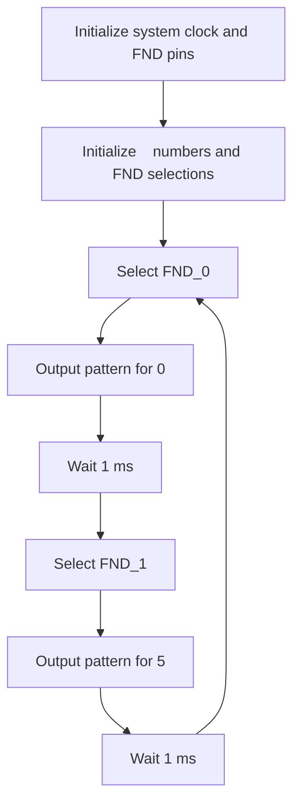
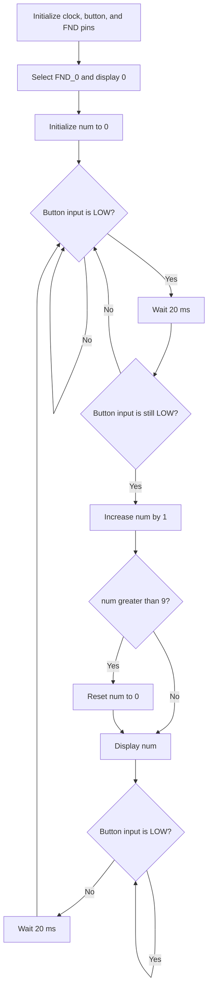

# LAB: GPIO 7-segment

**Date**: 2026-09-21

**Author**: 22200551 / Yejun Lee

**Github**: https://github.com/junflower4-dotcom

**Demo Video**: 

- Problem2: https://youtu.be/DokYYO7cZpo


## Introduction

The purpose of this lab is to control a 7-segment display on the JKIT-NUCLEO board using GPIO input and output. First, an FND library is used to display numbers and select individual digits. Multiplexing is used to display different numbers on two FNDs that share the same segment pins. Then, a button-controlled counter is implemented to increase the displayed number from 0 to 9 with each button press and return to 0 after 9. Through this lab, GPIO configuration, FND control, and button input handling are practiced.


## Requirement

### Hardware

- MCU
  - NUCLEO-F411RE
- Actuator/Sensor/Others:
  - eval board

### Software

- PlatformIO, CMSIS, EC_HAL library


## Exercise

| Port/Pin       | Description                  | Register setting                          |
| -------------- | ---------------------------- | ----------------------------------------- |
| Port B pin 5   | Clear Pin5 mode              | GPIOB → MODER &=~(3<<(5*2))               |
| Port B pin 5   | Set Pin5 mode = Output       | GPIOB->MODER \|= (1<<(5*2))               |
| Port B pin 6   | Clear Pin6 mode              | GPIOB->MODER &=~(3<<(6*2))                |
| Port B pin 6   | Set Pin6 mode = Output       | GPIOB->MODER \|=(1<<(6*2))                |
| Port B pin Y   | Clear PinY mode              | GPIOB->MODER &=~(3<<(Y*2))                |
| Port B pin Y   | Set PinY mode = Output       | GPIOB->MODER \|=(1<<(Y*2))                |
| Port B Pin 5~9 | Clear Pin5~9 mode            | GPIOB->MODER &=~(0x3FF<<(5*2))            |
|                | Set Pin5~9 mode = Output     | GPIOB->MODER \|=(0x155<<(5*2))            |
| Port X Pin Y   | Clear Pin Y mode             | GPIOX->MODER &=~(3<<(Y*2))                |
|                | Set Pin Y mode = Output      | GPIOX->MODER \|=(1<<(Y*2))                |
| Port B Pin5    | Set Pin5 otype=push-pull     | GPIOB-> OTYPER &=~(1<<5)                  |
| Port B PinY    | Set PinY otype=push-pull     | GPIOB-> OTYPER &=~(1<<Y)                  |
| Port B Pin5    | Set Pin5 ospeed=Fast         | GPIOB-> OSPEEDR \|=(2<<(5*2))             |
| Port B PinY    | Set PinY ospeed=Fast         | GPIOB-> OSPEEDR \|=(2<<(Y*2))             |
| Port B Pin 5   | Set Pin5 PUPD=no pullup/down | GPIOB->PUPDR = GPIOB->PUPDR & ~(3<<(5*2)) |
| Port B Pin Y   | Set PinY PUPD=no pullup/down | GPIOB->PUPDR = GPIOB->PUPDR & ~(3<<(Y*2)) |

 

## Problem 1. Library for 7-segment display on JKIT Board

### Procedure

1. Connect the evaluation board (JKIT-NUCLEO) to the MCU.
2. Make sure that your library **ecGPIO2.h, ecGPIO2.c** are in `EC\include\`.
3. Create a new project under the directory `EC\lab\`
   - Environment: “**LAB_GPIO_7segment_22200551”**
   - Source File: “**LAB_GPIO_7segment_22200551.c”**
4. Modify the `platformio.ini` **,** to add new environment.
5. Define the segment-pin and digit-selection arrays.
6. Initialize the system clock and FND GPIO pins.
7. Select FND_0 and display 0 for approximately 1 ms.
8. Select FND_1 and display 5 for approximately 1 ms.
9. Repeat the sequence continuously and observe the display.


### Configuration


| Function                           | Port - Pin                                                   | Configuration                 |
| ---------------------------------- | ------------------------------------------------------------ | ----------------------------- |
| **Selection of 7-Segment Display** | PA_10, PA_11, PC_4, PC_3 <br />(FND_0~FND_3)                 | DOUT, Push-Pull,              |
| **7-Segment LEDs**                 | PB_0, PB_1, PB_2, PB_3, PB_4, PB_5, PB_6, PB_7 <br />('a'~'g''dot', respectively) | DOUT, Push-Pull, Medium Speed |


### Algorithm

#### Overview

##### Flowchart




#### Description with Code

- The `pinFND` array stores the GPIO pins connected to segments a-g and the dot.

```c
PinName_t pinFND[8] = { PB_0, PB_1, PB_2, PB_3, PB_4, PB_5, PB_6, PB_7 };
```

- The `selectFND` array stores the selection pins for FND_0 through FND_3.

```c
PinName_t selectFND[4] = { PA_10, PA_11, PC_4, PC_3 };
```

- The `setup()` function initializes the system clock, segment pins, and FND selection pins.

```c
void setup(void) { 
    RCC_HSI_init(); 
    FND_init(pinFND); 
    FND_select_init(selectFND);
}
```

- The program calls `setup()` before controlling the displays.

```c
setup();
```

- The variables `numDisplay1` and `numDisplay2` store the numbers to display: 0 and 5.

```c
uint8_t numDisplay1 = 0; 
uint8_t numDisplay2 = 5;
```

- The variables `selectFND1` and `selectFND2` specify the displays to use: FND_0 and FND_1.

```c
uint8_t selectFND1 = 0;
uint8_t selectFND2 = 1;
```

- The program selects FND_0, displays 0, and waits for approximately 1 ms.

```c
FND_select(selectFND1); 
FND_display(numDisplay1);
delay_ms_HSI(1);
```

- The program then selects FND_1, displays 5, and waits for approximately 1 ms.

```c
FND_select(selectFND2); 
FND_display(numDisplay2); 
delay_ms_HSI(1);
```

- The `while (1)` loop repeats these operations continuously. Switching rapidly between the two FNDs makes both numbers appear continuously displayed.

```c
while (1) {
    FND_select(selectFND1);
    FND_display(numDisplay1);
    delay_ms_HSI(1);
    FND_select(selectFND2);
    FND_display(numDisplay2);
    delay_ms_HSI(1);
}
```


### Results and Discussion

#### Results

The program alternately selects FND_0 and FND_1 and outputs the patterns for 0 and 5, respectively. Each display phase includes a 1 ms delay, and the sequence repeats continuously.

With correct FND library operation, FND_0 is expected to show 0 and FND_1 to show 5. The rapid switching should make both numbers appear continuously displayed. The numbers remain unchanged because the display variables are not modified inside the loop.


#### Discussion

The program uses the same segment pins to display different numbers on two FNDs. `FND_select()` determines which FND is active, while `FND_display()` sets the number to display. By alternating these operations, the program displays 0 on FND_0 and 5 on FND_1.

Although the two FNDs appear to be on at the same time, they are actually selected one at a time. Each display phase lasts approximately 1 ms before the program switches to the other FND. Repeating this process rapidly makes both numbers appear continuously displayed.

The delay between switching affects the display behavior. If the delay is too long, the alternating operation may become visible as flickering. Therefore, maintaining a short and regular refresh interval is important when using multiple FNDs. If additional functions such as button input are added, they should be implemented without stopping the display refresh for a long time.


## Problem 2: Counter with Button Press

### Procedure

Create a code that increases the displayed number from 0 to 9 with each button press.

- After the number '9', it should start from '0' again.
- Modify from Problem 1 source code.
- Configure SW2 (PA_4) as an input with a pull-up resistor.
- Initialize the FND pins, select FND_0, and display 0.
- Increase the number with each button press and return to 0 after 9.
- Add a 20 ms debounce delay and wait for button release to prevent repeated counting.
- Upload the program and verify the counter operation.


### Configuration

| Function                           | Port - Pin                                                   | Configuration                                 |
| ---------------------------------- | ------------------------------------------------------------ | --------------------------------------------- |
| **Button (SW2) on JKIT**           | PA_4                                                         | DIN, Pull-Up                                  |
| **7-Segment DOUT**                 | PB_0, PB_1, PB_2, PB_3, PB_4, PB_5, PB_6, PB_7 <br />('a'~'g''dot', respectively) | Push-Pull, No Pull-up-Pull-down, Medium Speed |
| **Selection of 7-Segment Display** | PA_10 (FND_0)                                                | DOUT, Push-Pull,                              |


### Algorithm

#### Overview

##### Flowchart




#### Description with Code

- `BUTTON_PIN` is defined as PA_4, which is connected to SW2 on the JKIT board.

```cpp
#define BUTTON_PIN PA_4
```

- The `pinFND` array stores the GPIO pins connected to segments a-g and the dot.

```c
PinName_t pinFND[8] = { 
    PB_0, PB_1, PB_2, PB_3,
    PB_4, PB_5, PB_6, PB_7 
};
```

- The `selectFND` array stores the selection pins for FND_0 through FND_3.

```c
PinName_t selectFND[4] = { PA_10, PA_11, PC_4, PC_3 };
```

- The system clock is initialized using HSI. The button pin is configured as a digital input with a pull-up resistor. The button input is HIGH when released and LOW when pressed.

```c
RCC_HSI_init(); 
GPIO_init(BUTTON_PIN, INPUT);
GPIO_pupd(BUTTON_PIN, PU);
```

- The segment and digit-selection pins are initialized. FND_0 is then selected, and the initial number 0 is displayed.

```c
FND_init(pinFND); 
FND_select_init(selectFND);
FND_select(0);
FND_display(0);
```

- The program calls `setup()` and initializes the counter variable `num` to 0.

```c
setup();
uint8_t num = 0;
```

- The program detects a possible button press when the input is LOW. It waits 20 ms and checks the input again to reduce the effect of contact bounce.

```c
if (GPIO_read(BUTTON_PIN) == LOW) {
    
    delay_ms_HSI(20);
    
    if (GPIO_read(BUTTON_PIN) == LOW) { 
        // Update the counter and display
    }
}
```

- If the button remains pressed after the delay, `num` increases by one. When the value exceeds 9, it resets to 0.

```c
num++; 

if (num > 9) 
    num = 0;
```

- The updated number is displayed on FND_0. The selected display does not change inside the main loop.

```c
FND_display(num);
```

- The program waits until the button is released to prevent repeated counting while it is held. A further 20 ms delay helps reduce the effect of release bounce.

```c
while (GPIO_read(BUTTON_PIN) == LOW) {} 
delay_ms_HSI(20);
```


### Results and Discussion

#### Results

The expected behavior is a single-digit counter on FND_0. The initial display is 0, and each accepted button press increases the number by one. After 9, the next accepted press returns the display to 0.

While the button is held, the program waits for release without increasing the counter again. When no new press is detected, the previously displayed number remains unchanged.

#### Demo Video: 

https://youtu.be/DokYYO7cZpo


#### Discussion

1. Analyze the result and explain any other necessary discussion.

   The program is designed to display 0 initially and increase the number by one with each accepted button press. After 9, the next press returns the display to 0. Since SW2 uses a pull-up configuration, a LOW input indicates a pressed button. The 20 ms delay followed by a second input check helps reduce the effect of contact bounce. Waiting for button release prevents repeated counting while the button remains pressed. The actual experiment should confirm the counting sequence, wrap-around operation, and response to a long press.

2. What are the common cathode and common anode of 7-segment display?

   In a common-cathode 7-segment display, the cathodes of the LEDs are connected together, usually to GND. A segment turns ON when a HIGH signal is applied to its anode through a current-limiting resistor.

   In a common-anode display, the anodes are connected together, usually to the positive supply. A segment turns ON when its cathode is driven LOW through a current-limiting resistor. Therefore, directly driven common-cathode and common-anode displays require opposite segment-control levels.

3. Does the LED of a 7-segment display (common anode) pin turn ON when 'HIGH' is given to the LED pin from the MCU?

   No. For a directly driven common-anode display with compatible supply and GPIO voltage levels, applying HIGH to a segment’s cathode turns the LED OFF. Driving the cathode LOW allows current to flow from the common anode through the LED to the output pin, turning the segment ON. If a driver circuit is placed between the MCU and the display, the required MCU output level depends on whether that circuit inverts the signal.

4. How can we display 4 digit-numbers on the 4 FNDS at the same time? How to remove ghosting of displaying a number?

   Four different digits can be displayed using multiplexing. The program enables one FND at a time, outputs the corresponding segment pattern, and then moves to the next FND. Repeating this sequence rapidly makes all four digits appear continuously displayed. For example, if each digit is active for approximately 1 ms, a complete scan takes about 4 ms, corresponding to a refresh rate of approximately 250 Hz per digit, excluding code execution time.

   Ghosting can occur when a digit remains enabled while the segment pattern changes, causing an unintended pattern to appear briefly. To prevent this, the program should disable all FNDs, update the segment outputs, and then enable only the intended FND. If the driver requires time to turn off, a short blanking interval can be added before enabling the next digit. When this method is combined with the button counter, display refresh must continue during button handling.

