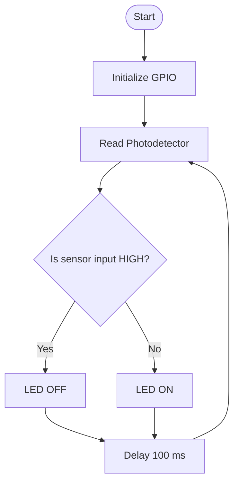
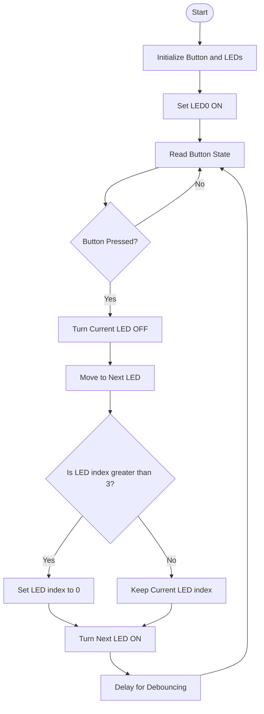

# LAB: GPIO Digital InOut

**Date**: 2026-09-19

**Author**: 22200551 / Yejun Lee

**Github**: https://github.com/junflower4-dotcom

**Demo Video**: 

- problem0: https://youtu.be/SpMGtsEUjx8
- problem2: https://youtube.com/shorts/8Ag6UB8OXyM
- problem3: https://youtube.com/shorts/e07x_aq0Ybc?feature=share


## Introduction

In this lab, GPIO digital input and output were implemented using the NUCLEO-F411RE and JKIT evaluation board.

GPIO driver functions were implemented and tested using a photodetector, push button, and LEDs.


## Requirement

### Hardware

- MCU
  - NUCLEO-F411RE
- Eval Board
- Actuator/Sensor/Others:
  - LEDs
  - Push Button
  - Photodetector

### Software

* PlatformIO, CMSIS, EC_HAL library

----


## Problem 0: STM-Arduino

We are going to create a simple program that turns LED(LD2) on and off by pressing the user button(BT1), using Arduino Syntax

### Procedure

- Create a new project under the directory`\repos\EC\lab\`.
  - Set the project folder name as `LAB_GPIO_DIO_LED`.
- Connect `PC13` to Arduino pin `D3` using a wire.
- Upload the Arduino code to the NUCLEO-F411RE.
- Press the user button and check the operation of LD2.

### Configuration

| **Function**       | **Port / Pin**         | **Configuration** |
| ------------------ | ---------------------- | ----------------- |
| **User Button B1** | **PC13 → D3**          | **Digital IN**    |
| **LD2**            | Pin 13 in Arduino code | Digital OUT       |


### Circuit/Wiring Diagram


### Algorithm

#### Overview

##### Flowchart

````mermaid
flowchart TD
    A([Start]) --> B[Initialize button as INPUT]
    B --> C[Initialize LED as OUTPUT]
    C --> D[Read button state]
    D --> E{Is button pressed?}
    E -- Yes --> F[Turn LED ON]
    E -- No --> G[Turn LED OFF]
    F --> H[Repeat]
    G --> H
    H --> D
   
````


#### Description with Code

```c++
const int btnPin = 3;
const int ledPin = 13;

int btnState = HIGH;

void setup() {
  pinMode(ledPin, OUTPUT);
  pinMode(btnPin, INPUT);
}

void loop() {
  btnState = digitalRead(btnPin);

  if (btnState == HIGH) 
    digitalWrite(ledPin, LOW);
  
  else 
    digitalWrite(ledPin, HIGH);
  
}
```


### Results and Discussion

#### Results

when the user button was pressed, LD2 turned ON.

when the user button was released, LD2 turned OFF.


#### Demo Video

https://youtu.be/SpMGtsEUjx8


#### Discussion

In this problem, basic GPIO digital input and output were tested using Arduino syntax. The user button was configured as a digital input, while LD2 was configured as a digital output. The button state was read using `digitalRead()`, and the LED was controlled using `digitalWrite()`.

Since the user button is connected to `PC13`, `PC13` was connected to Arduino pin `D3` using a wire so that the button state could be read by the Arduino program. When the button was pressed, the input state changed and the program turned LD2 ON. This experiment demonstrated how a digital input signal can be used to control a digital output.


## Problem 1: Create EC_HAL library

### Procedure

#### Prepare Library Files

The GPIO library was created using the provided EC_HAL library files.

The following files were prepared in `\repos\EC\include\`.

- `ecRCC2.h, ecRCC2.c`
- `ecPinNames.h, ecPinNames.c`
- `ecGPIO2.h, ecGPIO2.c`

The original files `ecGPIO2_student.h, ecGPIO2_student.c` were renamed as `ecGPIO2.h, ecGPIO2.c`.

The include statement in `ecGPIO2.c` was also modified to:

```cpp
#include "ecGPIO2.h"
```

**Function Definitions**

**ecGPIO2.h**

```cpp
void GPIO_init(PinName_t pinName, int mode);
void GPIO_write(PinName_t pinName, int Output);
int  GPIO_read(PinName_t pinName);
void GPIO_mode(PinName_t pinName, int mode);
void GPIO_ospeed(PinName_t pinName, int speed);
void GPIO_otype(PinName_t pinName, int type);
void GPIO_pupd(PinName_t pinName, int pupd);
```


### Algorithm

#### Description with Code

- **GPIO_init()** 

```cpp
void GPIO_init(PinName_t pinName, uint32_t mode){     
	GPIO_TypeDef * Port;
	unsigned int pin;
	ecPinmap(pinName, &Port, &pin);
	
	// mode  : Input(0), Output(1), AlterFunc(2), Analog(3) 
	if (Port == GPIOA)
		RCC_GPIOA_enable();
	if (Port == GPIOB)
		RCC_GPIOB_enable();
	if (Port == GPIOC)
		RCC_GPIOC_enable();
	if (Port == GPIOD)
		RCC_GPIOD_enable();
	if (Port == GPIOE)
		RCC_GPIOE_enable();

	// void RCC_GPIO_enable(GPIO_TypeDef *Port);

	GPIO_mode(pinName, mode);
}
```

- **GPIO_write()**

```cpp
void GPIO_write(PinName_t pinName, uint32_t Output){
	GPIO_TypeDef *Port;
	unsigned int pin;
	ecPinmap(pinName, &Port, &pin);

	Port->ODR &= ~(1UL << pin);  // Clear the bit
	Port->ODR |= (Output << pin);  // Set the bit according to Output

}
```

- **GPIO_read**

```cpp
uint32_t GPIO_read(PinName_t pinName){
	GPIO_TypeDef * Port;
	unsigned int pin;
	ecPinmap(pinName,&Port,&pin);

	uint32_t val=0;
	val = (Port->IDR >> pin) & 1UL; 
	return val; 	
}
```

- **GPIO_mode**

```cpp
void GPIO_mode(PinName_t pinName, uint32_t mode){
   GPIO_TypeDef * Port;
   unsigned int pin;
   ecPinmap(pinName,&Port,&pin);

   Port->MODER &= ~(3UL<<(2*pin));     
   Port->MODER |= mode<<(2*pin);    
}
```

- **GPIO_ospeed**

```cpp
void GPIO_ospeed(PinName_t pinName, uint32_t speed){
	GPIO_TypeDef * Port;
	unsigned int pin;
	ecPinmap(pinName,&Port,&pin);

	Port->OSPEEDR &= ~(3UL<<(2*pin));
	Port->OSPEEDR |= speed<<(2*pin);
}
```

- **GPIO_otype**

```cpp
void GPIO_otype(PinName_t pinName, uint32_t type){
	GPIO_TypeDef * Port;
	unsigned int pin;
	ecPinmap(pinName,&Port,&pin);

	Port->OTYPER &= ~(1UL<<pin);
	Port->OTYPER |= type<<pin;
}
```

- **GPIO_pupd**

```cpp
void GPIO_pupd(PinName_t pinName, uint32_t pupd){
	GPIO_TypeDef * Port;
	unsigned int pin;
	ecPinmap(pinName,&Port,&pin);

	Port->PUPDR &= ~(3UL<<(2*pin));
	Port->PUPDR |= pupd<<(2*pin);
}
```


### Results and Discussion

#### Discussion

Through this problem, the GPIO registers used for digital input and output were examined.

- `MODER`: GPIO input/output mode
- `PUPDR`:  Pull-up/Pull-down configuration
- `OTYPER`: Output type
- `OSPEEDR`: Output speed
- `IDR`: Digital input
- `ODR`: Digital output

The GPIO functions implemented in the EC_HAL library allow GPIO operations to be performed without directly accessing the registers in the main application code.


## Problem 2: Toggle a single LED with Digital Sensor(Photodetector)

### Problem

Toggle the LED by covering the photodetector sensor.

- Dark (LED ON), Bright (LED OFF) and repeat
- Connect the Photodetector sensor to PA_0 pin on Nucleo Board.


### Procedure

1. Connect the evaluation board (JKIT-NUCLEO) to the MCU.

2. Make sure that `ecGPIO2.h` and `ecGPIO.c` are located in `EC\include\`. 

3. Create a new project under the directory `EC\lab\`

   - Environment: “**LAB_GPIO_DIO_LED_Photosensor”.**
   - Source File: “**LAB_GPIO_DIO_LED_Photosensor.c”**

4. Modify `platformio.ini` to add the new environment.

5. Upload the program.

6. Expose and cover the photodetector and observe LED0.

   

### Configuration

| Function                  | Port-Pin | Configuration                                      |
| ------------------------- | -------- | -------------------------------------------------- |
| **Photodetector on JKIT** | PA_0     | Digital IN, Pull-Up                                |
| **LED0**                  | PB_12    | Digital OUT, Pull-UP, <br>Open-Drain, Medium Speed |


### Algorithm

#### Overview

##### Flowchart



#### Description with Code

- `PA_0` is used as the digital input from the photodetector, and `PB_12` is used as the LED output.

```cpp
#define LED_PIN PB_12
#define BUTTON_PIN PA_0
```

- The photodetector input is read using:

```cpp
buttonState = GPIO_read(BUTTON_PIN);
```

- The LED is controlled according to the sensor state.

```cpp
if(buttonState)
    GPIO_write(LED_PIN, LOW);
else
    GPIO_write(LED_PIN, HIGH);
```

- A 100 ms delay is applied.

```cpp
delay_ms_HSI(100);
```


### Results and Discussion

#### Result

- Bright Condition


- Dark Condition


#### Demo Video

https://youtube.com/shorts/8Ag6UB8OXyM


#### Discussion

The photodetector was used as a digital input through `PA_0`.

The input state was read using `GPIO_read()`, and LED0 connected to `PB_12` was controlled using `GPIO_write()`.

This experiment confirmed that the GPIO input and output functions implemented in Problem 1 could be used with an actual digital sensor(Photodetector) and LED.


## Problem 3: Toggle multiple LEDs with a button

### Problem

Use the four LEDs (LED0 to LED3) on the JKIT evaluation board.

Each time Button B1 is pressed, turn on one LED at a time in a sequential loop

- e.g., LED0 -> LED1 -> LED2 -> LED3 -> LED0)


### Procedure

1. Connect the evaluation board (JKIT-NUCLEO) to the MCU.
2. Make sure that **ecGPIO2.h, ecGPIO2.c** are in `EC\include\`.
3. Create a new project under the directory `EC\lab\`
   - Environment: “**LAB_GPIO_DIO_multiLED_22200551”**
   - Source File: ““**LAB_GPIO_DIO_multiLED_22200551.c”**
4. Modify `platformio.ini` to add the new environment.
5. Upload the program.
6. Press SW2 repeatedly and observe the LED sequence.


### Configuration

| Function        | Port-Pin                   | Configuration                                      |
| --------------- | -------------------------- | -------------------------------------------------- |
| **SW2 on JKIT** | PA_4                       | Digital IN, Pull-Up                                |
| **LED_0~LED_3** | PB_12, PB_13, PB_14, PB_15 | Digital OUT, Pull-UP, <br>Open-Drain, Medium Speed |


### Algorithm

#### Overview

##### Flowchart



#### Description with Code

- The push button `SW2` is connected to `PA_4`, and four LEDs are connected to `PB_12` through `PB_15`.

```cpp
#define LED_PIN_0 PB_12
#define LED_PIN_1 PB_13
#define LED_PIN_2 PB_14
#define LED_PIN_3 PB_15

#define BUTTON_PIN PA_4
```

- The push button is configured as a digital input with pull-up. Each LED is configured as a digital output with pull-up, open-drain, and medium speed.

```cpp
GPIO_init(BUTTON_PIN, INPUT);
GPIO_pupd(BUTTON_PIN, PU);

GPIO_init(LED_PIN_0, OUTPUT);
GPIO_pupd(LED_PIN_0, PU);
GPIO_otype(LED_PIN_0, OPEN_DRAIN);
GPIO_ospeed(LED_PIN_0, MEDIUM_SPEED);
```

- The same output configuration is applied to `LED_PIN_1`, `LED_PIN_2`, and `LED_PIN_3`.
- The variable `ledState` stores the number of the currently active LED.   Both the current and previous button states are initially set to `HIGH` because the button uses a pull-up configuration.

```cpp
int ledState = 0;
uint32_t buttonState = HIGH;
uint32_t prevButtonState = HIGH;
```

- At the beginning, LED0 is turned ON and the other LEDs are turned OFF.

```cpp
GPIO_write(LED_PIN_0, HIGH);
GPIO_write(LED_PIN_1, LOW);
GPIO_write(LED_PIN_2, LOW);
GPIO_write(LED_PIN_3, LOW);
```

- The current state of the push button is continuously read using `GPIO_read()`.

```cpp
buttonState = GPIO_read(BUTTON_PIN);
```

- Since the button uses pull-up configuration, the released state is `HIGH` and the pressed state is `LOW`.
- A new button press is detected when the button state changes from `HIGH` to `LOW`.

```cpp
if(buttonState == LOW && prevButtonState == HIGH)
```

- After detecting a button press, the program waits for 50 ms to reduce the effect of mechanical button bouncing.

```cpp
delay_ms_HSI(50);
```

- The button is then read again. The LED sequence is changed only when the button is still `LOW`.

```cpp
if(GPIO_read(BUTTON_PIN) == LOW)
```

- This software debouncing method helps prevent a single button press from being recognized as multiple presses.
- After a valid button press is confirmed, the currently active LED is turned OFF according to the value of `ledState`.

```cpp
if(ledState == 0)
    GPIO_write(LED_PIN_0, LOW);
else if(ledState == 1)
    GPIO_write(LED_PIN_1, LOW);
else if(ledState == 2)
    GPIO_write(LED_PIN_2, LOW);
else if(ledState == 3)
    GPIO_write(LED_PIN_3, LOW);
```

- The value of `ledState` is increased by one to select the next LED.

```cpp
ledState++;
```

- When `ledState` becomes greater than 3, it is reset to 0.

```cpp
if(ledState > 3)
    ledState = 0;
```

- Therefore, the LED sequence repeats as: `LED0 → LED1 → LED2 → LED3 → LED0`
- The LED corresponding to the updated `ledState` is turned ON.

```cpp
if(ledState == 0)
    GPIO_write(LED_PIN_0, HIGH);
if(ledState == 1)
    GPIO_write(LED_PIN_1, HIGH);
if(ledState == 2)
    GPIO_write(LED_PIN_2, HIGH);
if(ledState == 3)
    GPIO_write(LED_PIN_3, HIGH);
```

- As a result, one LED is active at a time, and each valid button press moves the active state to the next LED.
- At the end of each loop, the current button state is saved as the previous button state.

```cpp
prevButtonState = buttonState;
```


### Results and Discussion

#### Results

Each time SW2 was pressed, the active LED changed sequentially.

The LEDs operated in the following order:

`LED0 → LED1 → LED2 → LED3 → LED0`

Only one LED was turned ON at a time.

The 50 ms software debouncing delay helped prevent one button press from being recognized as multiple presses.


#### Demo Video

https://youtube.com/shorts/e07x_aq0Ybc?feature=share


#### Discussion

1. Find out a typical solution for software debouncing and hardware debouncing.

   **Software debouncing** removes button bouncing through software.   A common method is to wait for a short period after detecting a button state change and then read the button state again. If the state remains the same, the input is accepted as a valid button press.

   In this experiment, a 50 ms delay was used for software debouncing.

   ```cpp
   delay_ms_HSI(50);
   ```

   **Hardware debouncing** removes bouncing using electrical components.
    A typical method is to use an RC circuit consisting of a resistor and capacitor. The RC circuit filters rapid voltage changes caused by mechanical contact bouncing.

2. What method of debouncing did this NUCLEO board use for the push-button(B1)?

   According to the NUCLEO-F411RE schematic, the push-button(B1) connected to PC13 includes an RC network with resistors and a capacitor. This hardware filtering helps reduce the effect of mechanical switch bouncing.